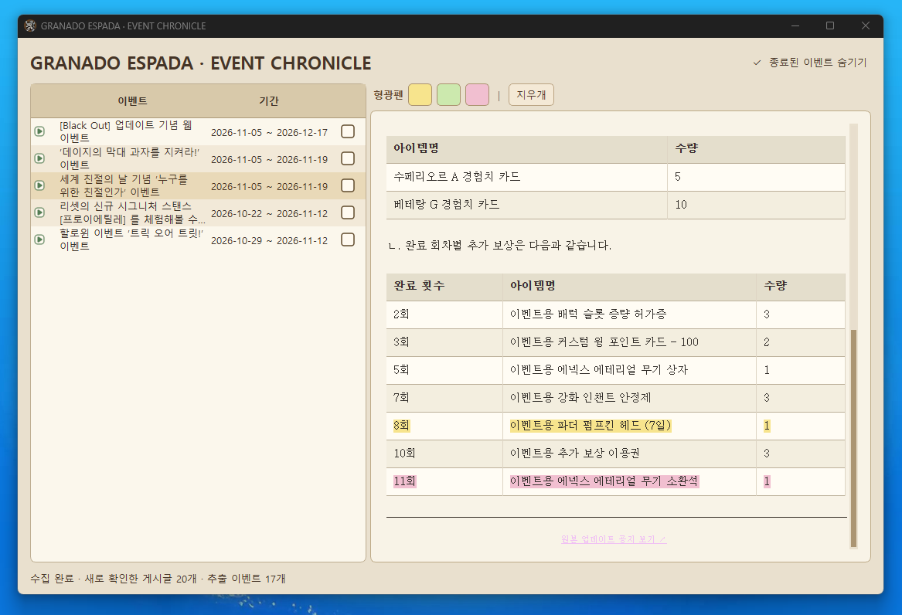

# GRANADO ESPADA · EVENT CHRONICLE

Granado Espada 공식 업데이트 공지에서 이벤트 정보를 정리하는 비공식 Windows 프로그램입니다.

## 배포 버전

**v1.1.0** — GitHub 공개 릴리스용 버전 번호입니다. 개발 중 사용한 내부 패키지 번호 `v19`의 기능을 담았습니다.

## 주요 기능

- 프로그램 시작 시 공식 업데이트 공지 첫 페이지 자동 확인
- 이벤트 기간(시작일/종료일)이 모두 확인된 항목만 표시
- 시작/종료 공지 중복 억제 및 종료된 이벤트 필터
- 이벤트별 숨김 체크박스와 숨김 복구
- 이벤트 설명/보상표를 빈티지 신문형 읽기 모드로 표시 (이미지 수집·표시 없음)
- 공식 링크가 확인된 경우 원본 업데이트 공지와 이벤트 페이지 연결
- 이벤트별 형광펜(노랑/연두/분홍) 및 현재 이벤트 형광펜 전체 지우기
- 「다음은 오탈자에 해당하는 사항입니다.」 이후 일반 업데이트 문구 제외

## Windows에서 직접 빌드하기

Python 3.11~3.13(64-bit)을 설치하고 `build_windows.bat`을 실행합니다. 성공하면 `dist/GE 이벤트.exe`가 생성됩니다.

빌드 시 공식 GE 홈페이지의 파비콘을 다운로드해 사용합니다. 다운로드 실패 시 임의 아이콘으로 대체하지 않고 빌드를 중단합니다.

## GitHub 릴리스 빌드

태그 `v1.1.0`을 GitHub에 푸시하면 `.github/workflows/windows-release.yml`이 Windows에서 EXE를 빌드한 뒤 GitHub Release에 첨부하도록 설정되어 있습니다. 해당 작업은 GitHub Actions 실행 권한 및 네트워크 접근이 필요하며 빌드 성공을 보장하지 않습니다.

## 데이터 주의

이벤트 정보, 숨김 상태, 형광펜 데이터는 `events.db`에 저장됩니다. 버전 업데이트 전 기존 DB를 백업하세요. 실제 사용자 데이터베이스는 저장소에 커밋하지 마세요.

## 검증 및 고지

이 소스는 개발 v19 패키지에 기반합니다. 공식 사이트 실수집, Windows UI 사용 및 GitHub Actions 빌드는 이 환경에서 최종 검증하지 못했습니다. 공식 게임 개발·운영사의 배포물이 아닙니다.
